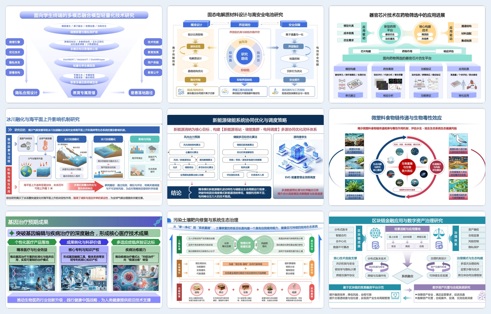
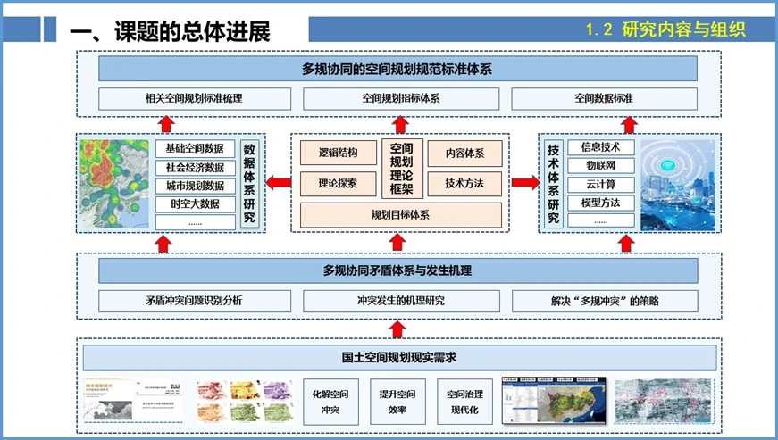
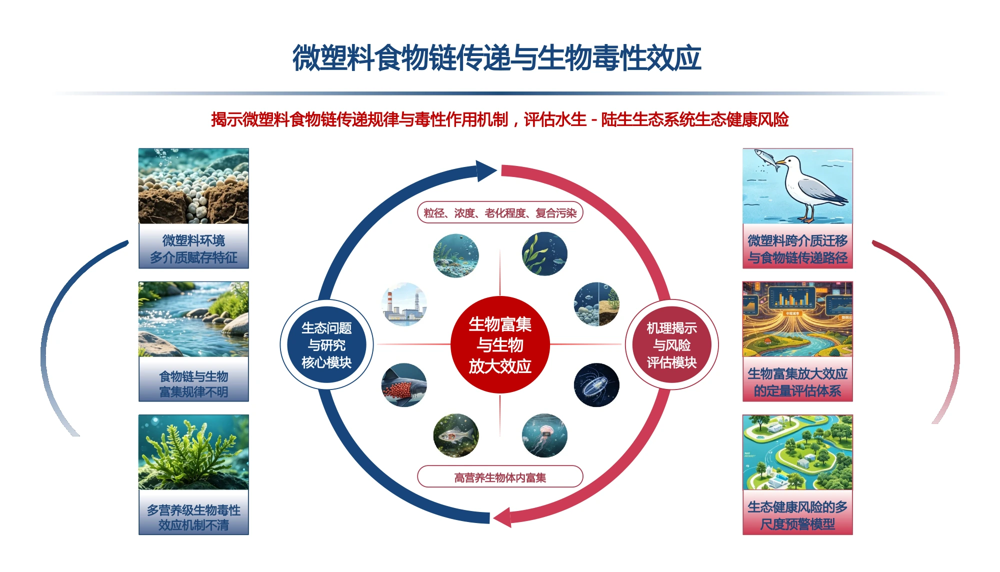
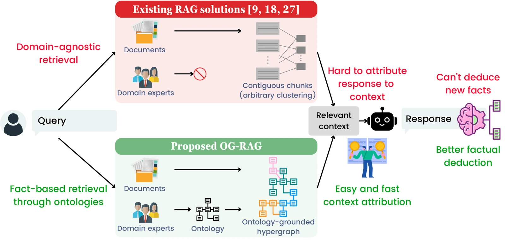

# img2ppt 技能包（给第三方工具用）

把这个目录交给别人的 AI 工具，它就能**在那边**把图片 / PDF 转成可编辑的 PPTX，
转图跑在我们服务器上，积分从用户在我们站上的账户里扣，不够了他回我们站充值。

技能本身只做两件事：调 HTTP 接口、等结果。它不碰我们的内部流程（不含 hermes、
docker、作业目录这些东西），所以可以整包拷进任何工具里。

## 效果预览



| 原图 | 可编辑 PPT 渲染 |
|---|---|
|  |  |
|  |  |
|  |  |

```
skills/img2ppt/
├── SKILL.md                  agent 读的说明书（怎么换令牌、怎么转、为什么慢、计价）
├── README.md                 这一份：给人看的安装说明
├── assets/                   示例图（原图 / 成品对照）
└── scripts/img2ppt.py        CLI：只用 Python 3 标准库，不需要 pip install
```

## 一、用户先要有一枚令牌

在站上（`https://image2ppt.asia/`）用邮箱登录 → **个人中心 → 设置登录密码** →
然后换令牌：

```bash
curl -s -X POST https://image2ppt.asia/api/auth/token \
  -H 'Content-Type: application/json' \
  -d '{"email":"用户的邮箱","password":"他刚设的密码","name":"claude-code"}'
```

响应里的 `token`（形如 `ppt_xxxxxxxx…`）**只显示一次**，让用户存好：

```bash
export IMG2PPT_TOKEN=ppt_xxxxxxxx
```

令牌与账号等价（能转图、能扣积分），所以：

* 别写进代码仓库、别贴进聊天记录；
* 泄露了立刻吊销 —— `curl -X POST $IMG2PPT_API/api/auth/token/revoke -H "Authorization: Bearer $IMG2PPT_TOKEN"`，
  或者让用户到站上登录后在同一个接口 `/api/auth/tokens` 里看到并吊销；
* 一个用户可以签多枚（不同工具各一枚），互不影响，上限 20 枚。

## 二、装进各种工具

**Claude Code / Claude Agent SDK（skill 目录）**

```bash
mkdir -p ~/.claude/skills
cp -r skills/img2ppt ~/.claude/skills/
```

之后说「把这张图转成 PPT」它就会用上；环境变量在 shell 里 export 好即可。

**WorkBuddy（本地技能目录）**

```bash
mkdir -p ~/.workbuddy/skills
cp -r skills/img2ppt ~/.workbuddy/skills/
```

**Cursor / Windsurf / 其他 IDE agent**：把 `SKILL.md` 的内容贴进项目的 rules
（`.cursor/rules/img2ppt.md` 或 `AGENTS.md`），脚本一起放进仓库，让 agent 直接
`python3 scripts/img2ppt.py convert <图>`。

**自己的脚本 / CI / 别的 agent 框架**：不用装任何东西，直接照 SKILL.md 里的接口表调：

```
POST /api/v1/convert      multipart: file, ratio, confirm_pages
GET  /api/v1/jobs/{id}    轮询 status / stage / preview / round / has_file
GET  /api/v1/jobs/{id}/pptx
```

## 三、计价（用户会问，先说清楚）

| | |
|---|---|
| 一张图 | 1 积分 |
| PDF | 每页 1 积分（超过余额会先让确认转前几页） |
| 失败 | 积分自动退回，不收费 |
| 上限 | 单文件 40MB、PDF 200 页 |
| 耗时 | 单张 20–40 分钟（一版一版和原图比对着改，通常十几版） |

积分不够时接口返回 **402**，响应里有 `recharge_url` —— 把地址给用户，
让他去站上充值（微信 / 支付宝），充完不用重新换令牌，直接重试即可。

## 四、怎么自查这套东西是通的

```bash
export IMG2PPT_API=https://image2ppt.asia
export IMG2PPT_TOKEN=ppt_xxx
python3 scripts/img2ppt.py me          # 看到邮箱和余额就说明令牌没问题
python3 scripts/img2ppt.py pricing     # 计价表
```

## 五、许可证

MIT。可以自由使用、修改和再分发；转换服务本身按站上计价收费。
